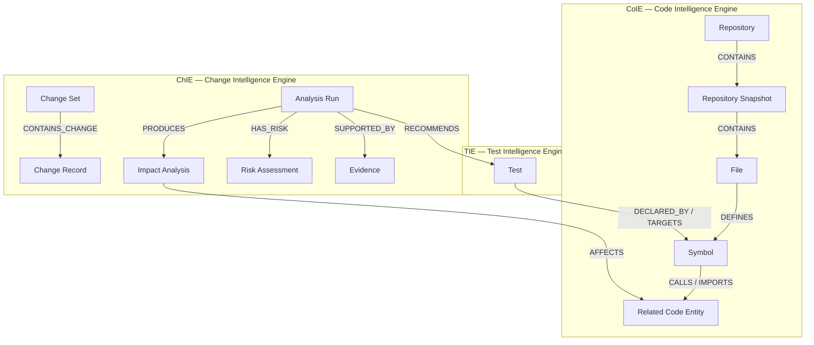

# CodeMind

CodeMind helps developers understand how code is connected and what a change might affect. Ask a question about a repository, and CodeMind builds a graph of its code and tests, analyzes related paths, and presents an explanation with evidence and limitations.

The project runs locally. It has three parts:

- **Next.js web app** — the interface and server-side AI agent.
- **Rust engine** — builds and queries code, test, and change graphs over gRPC.
- **FalkorDB** — stores the graph used by the Rust engine.

The web app talks to the Rust engine. The Rust engine talks to FalkorDB; the browser and Next.js do not connect to the database directly.

## How the engine graphs fit together

The Rust service contains three logical engines. Each owns a different kind of fact, even though they use the same FalkorDB workspace graph. The engines keep their own facts connected by references; they do not copy another engine's entities or change their meaning.



### What each graph contains

- **CoIE Code Graph:** the repository and the exact source snapshot, plus directories, files, modules, packages, and code symbols. Relationships such as `CONTAINS`, `DEFINES`, `IMPORTS`, and `CALLS` describe structure and dependencies. CoIE records a relationship only when the source and resolution process support it.
- **TIE Test Graph:** discovered test declarations and their supported associations with code. `DECLARED_BY` identifies where a test is declared; `TARGETS` records an association to code. Neither relationship proves that a test ran or that it covers the code. The current system discovers tests statically; it does not execute repository test code.
- **ChIE Change Graph:** the proposed change context, analysis run, impact analysis, risk assessment, recommendations, and supporting evidence. `AFFECTS` means a possible consequence of the proposed change, not a guaranteed failure. `RECOMMENDS` links to a TIE-owned test.

CoIE and TIE provide canonical repository facts; ChIE combines those facts to answer a change question. Every query is scoped to the repository, source snapshot, and graph version so data from different source states is not silently mixed. Rust Type B functions return bounded canonical JSON. Next.js validates those results, converts the model-facing copy through `flat` and TOON, and keeps structured data for the chat and analysis UI.

## Run CodeMind locally

You need Git, Docker Compose, Rust/Cargo, Node.js 22 or newer, and pnpm. Run the following setup commands from the repository root:

```bash
pnpm --dir apps/web install --frozen-lockfile
cp apps/web/.env.example apps/web/.env.local
```

Edit `apps/web/.env.local` before starting the app:

- Set `OPENROUTER_API_KEY` for AI-backed investigations.
- Replace `CODEMIND_SESSION_SECRET` with a random secret of at least 32 characters.
- Set `CODEMIND_DEV_AUTH_ENABLED=true` for the local development session.
- `CODEMIND_GITHUB_TOKEN` is optional for public repositories and needed for private repositories.

Keep this file private. Do not commit API keys or tokens.

Open three terminals in the repository. Start the services in this order: **FalkorDB first, then the Rust engine, then the web app.** The engine needs FalkorDB to be running before it starts.

### Terminal 1 — FalkorDB

From the repository root, run:

```bash
docker compose -f apps/web/docker-compose.yml up -d
```

Wait for the `falkordb` container to become healthy before starting the engine.

### Terminal 2 — Rust engine

From the repository root, run:

```bash
cargo run --manifest-path engine/Cargo.toml
```

The engine listens for gRPC connections on `127.0.0.1:50051` by default.

### Terminal 3 — Next.js web app

From the repository root, run:

```bash
cd apps/web
pnpm run dev
```

Open [http://localhost:3000](http://localhost:3000). Go to **Repositories** to add a GitHub repository, then start an investigation and ask a question in plain language.

## Stop the local services

Stop the Next.js and Rust processes with `Ctrl+C` in their terminals. Stop FalkorDB from the repository root with:

```bash
docker compose -f apps/web/docker-compose.yml down
```

Docker keeps the database volume so your local graph data remains available the next time you start CodeMind.

## Run checks

From `apps/web/`:

```bash
pnpm typecheck
pnpm test
pnpm test:e2e
```

From the repository root:

```bash
cargo test --manifest-path engine/Cargo.toml
```

Some end-to-end tests need FalkorDB, the Rust engine, and the web app running. See [`docs/testing.md`](docs/testing.md) for the testing plan and prerequisites.

## More information

- [Architecture](docs/architecture.md) — how the web app, agent, Rust engines, and graph database work together.
- [Design system](docs/design-system.md) — UI colors, components, and design rules.
- [Testing guide](docs/testing.md) — test coverage and end-to-end verification.
